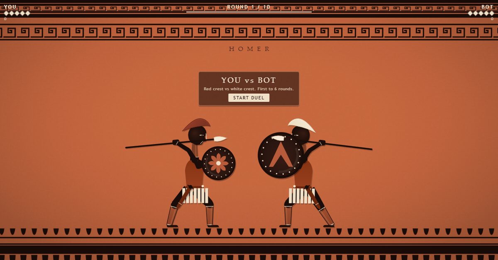

# Homer

A papercut hoplite duel for X Player Cards. You are the red-crested warrior on
the left; the bot is the white-crested warrior on the right. Spears, round
shields, five hits per round, first to six.



Built with Dart and Canvas 2D, with no runtime dependencies and no external
assets. The page is a static site: `index.html`, `app.js`, and `preview.png`.

## Play

Hosted at **https://xyzzyapps.github.io/spear/**.

- `A` / `D` or Left/Right Arrow: step back / forward
- `J` or `Space`: attack
- `K` or `Shift`: hold to block
- `Enter`: start / rematch
- Touch: `BACK`, `FWD`, `ATTACK`, hold `BLOCK`

A fresh block (inside 0.15 s) parries and staggers the attacker. A held block
absorbs the thrust. Five hits end a round. The first to six round wins takes
the match; 5-5 after ten rounds goes to sudden death.

## Requirements

- Dart SDK 3.13 or newer (`dart --version`).
- Chrome or Edge for the optional browser smoke test.
- No pub packages are downloaded; `dart pub get` only writes the local package
  configuration.

## Run locally

```powershell
dart pub get
dart run tool/build.dart
dart run tool/serve.dart
```

Open `http://127.0.0.1:4173/`.

`tool/build.dart` runs `dart format .`, `dart analyze`, and
`dart compile js -O2 --no-source-maps web/main.dart -o app.js`. The generated `app.js` is
committed so the static site can be deployed without a build step.

To serve a different port, edit `_port` in `tool/serve.dart` and the smoke test
URL if you use it.

## Test

```powershell
dart analyze
dart run tool/test.dart
```

The VM suite covers math/IK, fighter transitions, combat, match flow, sudden
death, bot determinism, difficulty, input snapshots, and the bot-disabled
debug path.

Browser smoke test (with the dev server running):

```powershell
dart run tool/smoke.dart
```

It starts Chrome headless, emulates 480x270, clicks `START DUEL`, checks block,
attack, and movement input through the real page, and writes
`build/smoke_idle.png`, `smoke_block.png`, `smoke_attack.png`, `smoke_walk.png`,
and `smoke.png`.

Distribution check:

```powershell
dart run tool/check.dart
```

It verifies the X Player Card tags, local-only `src`/`href` assets, `.nojekyll`,
`app.js`, `design/ref.png`, and that `preview.png` is 1200x628.

## Balance

```powershell
dart run tool/sim.dart 40
```

This runs a scripted round-6 player against the scaling bot. The current
baseline is 30 player wins / 10 bot wins over 40 decided matches, 8.68 average
rounds, 89.1 average seconds, with no unfinished matches. Tune the constants in
`lib/game/fighter.dart` and the lerps in `lib/game/bot.dart`, then re-run.

## Deploy to GitHub Pages

Publish these root files:

- `index.html`
- `app.js`
- `preview.png`
- `.nojekyll`
- `design/ref.png` (optional; the runtime does not load it)

The intended repository path is `spear`, so the site is served from
`https://xyzzyapps.github.io/spear/`. If the repository name changes, update the
absolute `twitter:player` and image URLs in `index.html` and in this README.

`.nojekyll` must remain in the published root so GitHub Pages serves the files
directly.

## X Player Card

`index.html` contains:

- `twitter:card = player`
- `twitter:player = https://xyzzyapps.github.io/spear/`
- `twitter:player:width = 480`
- `twitter:player:height = 270`
- `twitter:image = https://xyzzyapps.github.io/spear/preview.png`
- `og:image` and `og:image:width/height` for the 1200x628 preview

Requirements and caveats:

- The page must be served over HTTPS.
- The domain/repository must pass X's Player Card validator.
- Do not add `X-Frame-Options: DENY` or a CSP `frame-ancestors` rule that blocks
  `x.com`.
- X may show only the preview image on some mobile clients; tapping opens the
  page. The page works in a normal browser and a mobile in-app browser.
- The game is designed for 480x270. Portrait browsers letterbox the scene and
  keep the HUD and touch controls at the edges; landscape is recommended.
- Keyboard input inside the timeline player can require a click/tap to focus.
  Touch controls are shown automatically on coarse pointers.

Replace the absolute URLs above if you publish under another account or repo.

## Capture the preview

With the dev server running:

```powershell
& "C:\Program Files\Google\Chrome\Application\chrome.exe" `
  --headless=new --hide-scrollbars --window-size=1200,628 `
  --virtual-time-budget=3000 `
  --screenshot="C:\Users\manic\Documents\PROG\spear\preview.png" `
  "http://127.0.0.1:4173/?preview=1"
```

For a clean 1600x766 reference capture:

```powershell
& "C:\Program Files\Google\Chrome\Application\chrome.exe" `
  --headless=new --hide-scrollbars --window-size=1600,766 `
  --virtual-time-budget=3000 `
  --screenshot="build\idle.png" `
  "http://127.0.0.1:4173/?pose=idle&ui=0"
```

## Project layout

```text
index.html                  page, CSS, HUD, X/Open Graph metadata
app.js                      compiled Dart entry
preview.png                 1200x628 social image
design/ref.png              visual reference (not loaded at runtime)
lib/
  app.dart                  boot, resize, animation loop, start/rematch
  core/logger.dart
  game/                     pure rules and state machines
  render/                   Canvas 2D papercut renderer
  ui/                       DOM HUD and keyboard/touch input
test/                       VM test harness and suites
tool/                       build, serve, test, check, smoke, sim
web/main.dart               query flags and composition root
```

The rules layer never imports `dart:html` or the renderer. The renderer reads a
`GameSnapshot` and fighter state; it never mutates them. Events are drained once
per frame for paper-scrap particles and debug logs.

`SPEC.md` contains the detailed requirements, state machines, timings, render
geometry, and verification notes.

## Debug flags

Append these to the page URL:

| Flag | Effect |
| --- | --- |
| `?debug=1` | console logs and a `data-*` snapshot on `<html>` |
| `?ui=0` | hide HUD, controls, and overlays for captures |
| `?preview=1` | static start screen with HUD and overlay; controls hidden |
| `?pose=STATE` | static pose: `idle`, `walk`, `windup`, `attack`, `recover`, `block`, `hit`, `stagger`, `dead` |
| `?t=SECONDS` | time/state time for the static pose; combine with `ui=0` for captures |
| `?seed=42` | deterministic bot RNG |
| `?autoplay=1` | start immediately |
| `?bot=off` | disable the bot for deterministic input checks |

`?bot=off` is a development aid only; normal play uses the bot.

## Notes

- The reference frame is 1600x766. The renderer draws in reference pixels and
  applies a responsive fit, so the frieze proportions stay stable at 480x270,
  1200x628, square, and ultrawide.
- The visual is a papercut interpretation of `design/ref.png`, not a pixel
  trace. The top and bottom friezes are procedural canvas textures.
- The spear is held in the overhand dory grip: palm over the shaft, pinky
  toward the tip. The spear hand is the reachable IK end with a wrist, fist,
  finger ridges, and thumb; the off-hand shield arm is a second joint chain.
- The neck is a visible brown column with a black gorget and cream collar
  between the torso and helmet.
- Hits draw blood: crimson droplets, a shield splat, a stain on the spear leaf,
  a short red screen flash, and blood-red empty HUD pips.
- Motion is procedural: a low planted-foot advance with weight transfer, a
  high spear draw that sweeps down into a sliding thrust, a shield punch and
  brace, recoil footwork, a stagger, and a buckle-then-fall death. The attacker
  is drawn last so the spear tip crosses the defender's shield. Use
  `?pose=STATE&t=...` to inspect individual poses.
- There is no audio, persistence, or network code.
- The game loop clamps `dt` to 33 ms, so a background tab or a slow frame cannot
  cause a huge simulation step.
