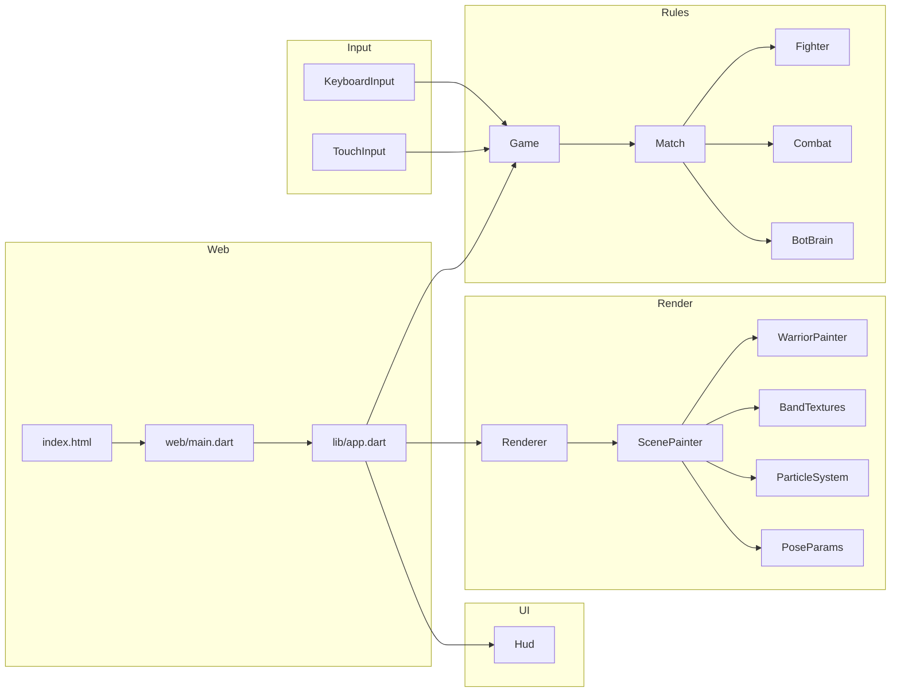
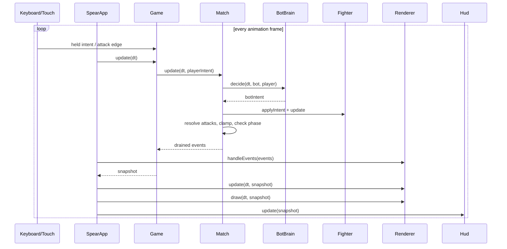
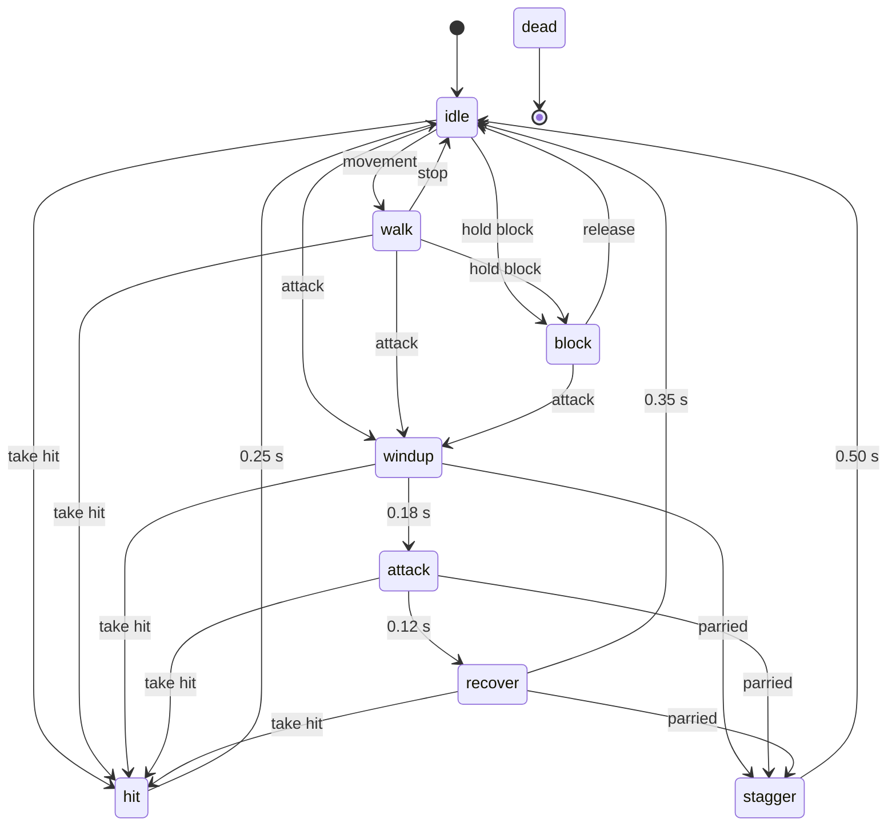
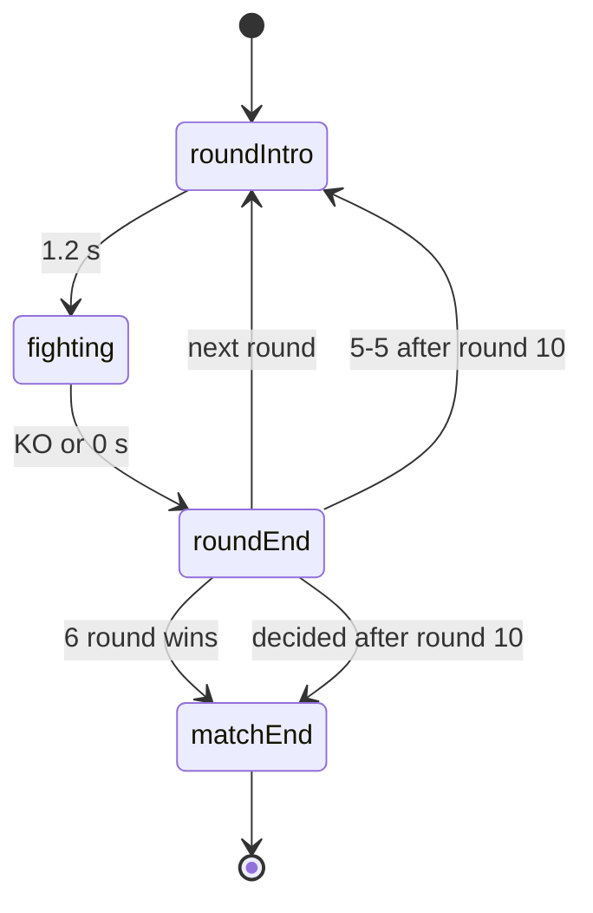

# Homer / Spear - Software Requirements Specification

Status: implemented, verified locally against Chromium and the Dart VM.

## 1. Overview

Homer is a Dart web game: a player-versus-bot papercut hoplite duel. The
player controls the red-crested warrior on the left; the bot controls the
white-crested warrior on the right. The game is a static site, has no runtime
dependencies, and is shaped for an X Player Card at 480x270 while remaining
playable full-screen.

The visual target is `design/ref.png`: a 1600x766 papercut frieze with a
terracotta sky, Greek-key bands, a cream meander frieze, and two hoplites with
spears, round shields, plumed helmets, and cream pteruges.

## 2. Goals and non-goals

Goals:

- A complete, playable duel with movement, attacks, blocks, parries, health,
  rounds, a timer, and a match result.
- A self-contained static distribution: `index.html`, `app.js`, `preview.png`.
- A papercut look that reads clearly at 480x270 and scales to 1200x628.
- Deterministic game logic and deterministic bot behaviour for a given seed.
- Local tooling for build, serve, tests, browser smoke tests, and balance.

Non-goals:

- Audio, music, networking, accounts, leaderboards, or saved progress.
- A pixel-perfect vector reconstruction of every brush stroke in the reference.
- A machine-learning bot. The bot is a small heuristic opponent.
- A native mobile build. The web page is the deliverable.

## 3. Distribution and host

- Intended host: `https://xyzzyapps.github.io/spear/`.
- Player Card size: 480x270.
- Preview image: 1200x628 (`preview.png`).
- The site is static and must be served over HTTPS for X Player Cards.
- The host must not send `X-Frame-Options: DENY` or a CSP
  `frame-ancestors` rule that blocks `x.com`.
- `index.html` carries the X Player Card and Open Graph tags. The absolute URLs
  are the GitHub Pages URLs above; change them if the repository is published
  under another name.
- `.nojekyll` keeps GitHub Pages from processing the site through Jekyll.

Required root files:

| File | Role |
| --- | --- |
| `index.html` | page, metadata, CSS, HUD, overlays, canvas |
| `app.js` | compiled Dart entry point |
| `preview.png` | 1200x628 social preview |
| `.nojekyll` | GitHub Pages passthrough |

## 4. Game rules

### 4.1 Match format

- Each round starts with both fighters at 5 HP.
- A hit removes 1 HP. A round ends when a fighter reaches 0 HP or the 30 second
  round timer expires.
- A round win is awarded to the survivor, or to the fighter with more HP on a
  timeout. Equal HP on timeout is a draw. A double K.O. is a draw.
- The match is best-of-10: the first fighter to 6 round wins wins the match.
- If the score is 5-5 after 10 rounds, round 11 is sudden death. If round 11 is
  also a draw, the match is a draw.
- The match state can end earlier than round 10 when one fighter reaches 6
  wins.
- `maxRounds` is 10. The round number is displayed as `ROUND n / 10`; round 11
  is displayed as `SUDDEN DEATH`.

### 4.2 Round flow

| Phase | Duration | Behaviour |
| --- | --- | --- |
| `roundIntro` | 1.2 s | banner `ROUND n`; inputs do not affect fighters |
| `fighting` | up to 30 s | inputs, bot decisions, combat, timer |
| `roundEnd` | 2.0 s | banner `K.O.`, `TIME - YOU`, `TIME - BOT`, or draw |
| `matchEnd` | indefinite | result overlay, rematch button |

The first `FIGHT` banner appears for 0.6 s when `fighting` begins.

### 4.3 Combat

| Property | Value |
| --- | --- |
| Max HP | 5 |
| Damage per hit | 1 |
| Attack windup | 0.18 s |
| Attack active | 0.12 s |
| Attack recovery | 0.35 s |
| Attack cooldown | 0.70 s |
| Attack range (body centres) | 3.25 units |
| Parry window (block age) | 0.15 s |
| Hit stun | 0.25 s |
| Block stun | 0.12 s |
| Parry stagger | 0.50 s |
| Walk speed | 1.10 units/s |
| Block walk speed | 0.45 units/s |
| Minimum separation | 2.45 units |
| Arena bounds | player -3.20..-0.70, bot 0.70..3.20 |
| Round timer | 30 s |
| Knockback on hit | 0.18 units |
| Knockback on block | 0.05 units |
| Knockback on parry | 0.12 units |

One world unit equals 100 reference pixels. The fighters start at x = -1.6 and
x = +1.6, facing each other. The attack range 3.25 means the opening stance is
just inside spear reach; a full thrust visually reaches the opposing shield.

Combat resolution:

1. If the body-centre distance is greater than 3.25, the thrust misses.
2. If the defender is dead, the thrust misses.
3. If the defender is blocking and `blockAge <= 0.15`, the thrust is parried.
4. If the defender is blocking and `blockAge > 0.15`, the thrust is blocked.
5. Otherwise the thrust hits.

A parry staggers the attacker for 0.50 s and applies a small block impact to
the defender. A blocked thrust does not damage. A hit sets the defender to
`hit`, or `dead` at 0 HP.

Both attacks are resolved before either is applied, so a simultaneous exchange
can produce a double K.O.

### 4.4 Controls

| Action | Keyboard | Touch |
| --- | --- | --- |
| Step back | A / Left Arrow | `BACK` |
| Step forward | D / Right Arrow | `FWD` |
| Attack | J / Space | `ATTACK` |
| Block (hold) | K / Shift | hold `BLOCK` |
| Start / rematch | Enter | `START DUEL` / `REMATCH` |

On coarse pointers the touch controls are shown; on fine pointers the hint
`A D MOVE · J ATTACK · K BLOCK` is shown. Touch buttons use hold semantics for
movement and block, and a tap for attack. Global mouse/touch release clears all
held movement and block so a pointer lost outside the button cannot stick.

## 5. Architecture

### 5.1 Module map



### 5.2 Frame sequence



### 5.3 Module responsibilities

| Module | Responsibility |
| --- | --- |
| `lib/game/math.dart` | clamp, lerp, easing, `Vec2`, two-bone IK |
| `lib/game/rng.dart` | deterministic xorshift32 |
| `lib/game/input.dart` | `FighterIntent`: forward, backward, attack edge, block hold |
| `lib/game/fighter.dart` | fighter state machine, movement, stun, HP, constants |
| `lib/game/combat.dart` | range, hit, block, parry resolution |
| `lib/game/bot.dart` | difficulty scaling, decisions, mistakes, opening delay |
| `lib/game/match.dart` | rounds, timer, phase machine, events, final result |
| `lib/game/game.dart` | composition root, start/rematch, input edge clearing, snapshots |
| `lib/core/logger.dart` | debug-gated `dart:developer` logging |
| `lib/render/frame.dart` | 1600x766 reference frame and responsive fit |
| `lib/render/palette.dart` | sampled colour constants |
| `lib/render/bands.dart` | procedural top and bottom friezes and patterns |
| `lib/render/pose.dart` | animation parameters per fighter state |
| `lib/render/warrior.dart` | papercut body, armour, shields, spear, shadows |
| `lib/render/particles.dart` | impact paper scraps |
| `lib/render/scene.dart` | title, bands, fighters, particles, shake input |
| `lib/render/renderer.dart` | canvas sizing, DPR transform, fit, shake |
| `lib/ui/hud.dart` | DOM pips, score, timer, banner, overlays, start button |
| `lib/ui/input.dart` | keyboard and touch wiring |
| `lib/app.dart` | boot, resize, animation loop, start/rematch, debug dataset |
| `web/main.dart` | query flags, logger, composition root |

### 5.4 Data flow

The game logic never imports the renderer or `dart:html`. This keeps the rules
testable on the Dart VM and makes the renderer replaceable. The renderer reads
a `GameSnapshot` and the fighter objects; it never mutates them. The HUD reads
the same snapshot. Events are drained once per frame for particles and logs.

## 6. State machines

### 6.1 Fighter



Blocking is a held state. A fresh block is a parry; a held block is a normal
block. `blockImpact` applies a short stun without leaving the block state.

Any non-dead state can transition directly to `dead` when a hit brings HP to 0;
`takeHit` sets `dead`, not `hit`, in that case. A defender in `block` is not
hit; the thrust is blocked or parried instead.

### 6.2 Match



The rematch path constructs a new `Match`, resets the scene poses and particles,
and increments the seed.

### 6.3 Bot

The bot is a decision timer plus a small intent generator, not a separate
fighter. It sees only the same fighter state a player can see.

For round `r`, `t = clamp((r - 1) / 9, 0, 1)`:

| Property | Round 1 | Round 10 | Formula |
| --- | --- | --- | --- |
| Reaction time | 0.24 s | 0.12 s | `lerp(0.24, 0.12, t)` |
| Aggression | 0.45 | 0.85 | `lerp(0.45, 0.85, t)` |
| Block chance | 0.35 | 0.78 | `lerp(0.35, 0.78, t)` |
| Mistake chance | 0.18 | 0.04 | `lerp(0.18, 0.04, t)` |
| Opening delay | 0.75 s | 0.35 s | `lerp(0.75, 0.35, t)` |

Decision rules:

1. If the bot is attacking, recovering, hit, staggered, or dead, emit no new
   action.
2. Decrement the decision and block-hold timers.
3. On a mistake, clear block and movement for this decision.
4. If the player is in windup or attack, within range + 0.45, and the block roll
   succeeds, raise the shield for 0.26..0.50 s.
5. If in range and the player is open (recover, hit, stagger), or the aggression
   roll succeeds, attack. A turtling player is attacked only 30% of the time.
6. Otherwise move forward when out of range, back off when too close, and
   occasionally retreat or hold.

The bot never modifies HP, positions, or states directly. It only emits a
`FighterIntent`, which is then applied by the same fighter code as the player.

## 7. Rendering

### 7.1 Reference frame

`design/ref.png` is 1600x766.

| Region | Rows |
| --- | --- |
| Top band | 0..118 |
| Title | around 145 |
| Content sky | 120..672 |
| Ground line | 673 |
| Bottom band | 673..765 |
| Figures | roughly 345..673 |

The renderer draws in reference pixels. The composition transform is:

```text
screen = dpr * scale * reference + dpr * (offset + shake)
```

All geometry, band patterns, particles, and the title use reference pixels;
only the CSS background, HUD, and controls use viewport pixels.

### 7.2 Responsive fit

```text
if viewportAspect >= 1:
    scale = viewportHeight / 766
    offsetX = (viewportWidth - 1600 * scale) / 2
    offsetY = 0
    visible reference x = -offsetX / scale .. (viewportWidth - offsetX) / scale
else:
    scale = viewportWidth / 1600
    offsetX = 0
    offsetY = (viewportHeight - 766 * scale) / 2
    visible reference x = 0 .. 1600
```

Landscape covers the height, cropping or extending the sides. Square and
portrait contain the full width and letterbox vertically. The bands are drawn
from the visible reference x range, so landscape ultrawide still has continuous
friezes. Portrait is intentionally a letterboxed poster: landscape is the
primary layout.

### 7.3 Warrior construction

The warrior is a local-unit papercut rig, 1 unit = 100 reference pixels. The
root is at the ground; the right warrior is mirrored. Key local points:

| Point | Local coordinate |
| --- | --- |
| Hip | (0, 1.06 - crouch) |
| Spear shoulder | (-0.04, hip.y + 0.78) |
| Shield shoulder | (0.08, hip.y + 0.76) |
| Head centre | (0.06, hip.y + 1.24) |
| Back hip | (-0.16, hip.y) |
| Front hip | (0.06, hip.y) |
| Back foot | (-0.75, 0.08) |
| Front foot | (0.45, 0.08) |
| Left shield centre | hand + (0.25, 0.08) |
| Shield radius left | 0.50 |
| Shield radius right | 0.68 |

The rig uses sculpted anatomical chains:

| Chain | Joints | Lengths |
| --- | --- | --- |
| Spear arm | shoulder, elbow, wrist, fist | 0.38 / 0.44, fist 0.136 |
| Shield arm | shoulder, elbow, wrist, hand | 0.34 / 0.34 |
| Legs | hip, knee, ankle, foot | 0.55 / 0.57 |
| Neck | shoulder collar to rotating helmet nape/throat | dynamic bezier |

Both human knees bend forward (`bend = +1`). The thighs use sculpted quadriceps
and hamstring contours, and the lower legs wear contoured Greek bronze greaves
(knemides) with a calf muscle swell, Achilles taper, and a cream patellar loop
and shin border matching `design/ref.png`. Feet have a rounded heel, arched
sole, and tapered forefoot that rotates around the ankle during locomotion and
lunges.

The spear arm uses `_solveSpearArm` to keep the elbow on the anatomical
lower-posterior side (`score = y + 0.35 * x`), forming the classic V-bent
overhand dory stance in idle/windup and driving the forearm forward and up on
the thrust without ever flipping the elbow above the shoulder. The grip sits
0.015 units below the reachable hand so the palm wraps over the shaft.

The neck is a dynamic quadratic bezier column connecting the shoulder collar to
the rotating helmet nape and throat attachment points, flexing naturally with
`headTilt` and `bodyLean`. The Corinthian helmet features a high cranial dome,
flared neck guard, pointed cheek guard, nasal projection, almond eye slot,
cream contour lines, and a high-arched horsehair crest with fine hair
striations.

The cuirass has a cream-rimmed shoulder cutout, waist boss fastener, segmented
belt, diagonal scabbard with cream chape bindings, and 6 layered pteruges strips
that swing with the torso lean.

Draw order, back to front:

1. Back leg (thigh, foot, contoured bronze greave).
2. Front leg (thigh, foot, contoured bronze greave).
3. Shield arm (behind the torso and shield).
4. Sword scabbard and layered pteruges skirt.
5. Torso cuirass, armhole plate, cream shoulder ring, and segmented belt.
6. Spear shaft with tapered rear sauroter and leaf spearhead with socket collar,
   central spine ridge, and blood stain (drawn before the head and shield so
   each warrior's spear passes behind their own helmet and shield).
7. Articulated bezier neck and collar line.
8. High-arched crest and Corinthian helmet.
9. Shield: outer rim, inner field gradient, dot ring, rosette or lambda;
   blood splats if the shield was hit.
10. Near spear arm (deltoid cap, bicep/tricep, elbow, forearm, cream wrist band,
    and overhand fist).

Each shape gets a manual paper shadow offset by roughly (2, 3) reference pixels
in screen space, so the light direction stays consistent when the right warrior
is mirrored.

### 7.4 Poses

`PoseParams` holds body lean, crouch, torso shift, hand offsets, spear tilt,
spear slide, shield tilt, head/crest tilt, root rotation, feet, foot rotations,
lunge, and bob. `poseFor(fighter, time)` returns the target for the current
state:

- Idle: a slow weight drift (`torsoShift`), breathing lean/crouch, shield and
  spear micro-motion, a lagging crest, and an overhand fist on the shaft.
- Walk: an athletic planted-foot gait. The stance foot travels backward under
  the body for 55% of the cycle with a mid-to-late stance heel-to-ball push-off
  roll while the swing foot lifts with an early-skewed knee pickup, travels
  forward, and drops its toe. The hips settle 0.05 units with a double-step
  vertical bob (`bob`) and pelvic crouch oscillation.
- Windup: lean back 0.14, torso shift back 0.06, crouch 0.07, spear hand pulled
  back 0.20 and up 0.08, spear tilt +0.36, spear slide -0.14, shield hand up
  0.12 and back 0.03, back foot braced back 0.04. The raised hand cocks the
  spear so the point aims slightly downward over the opposing shield rim.
- Attack: lunge 0.32, crouch 0.06, torso shift forward 0.09, forward lean 0.16,
  spear hand drive +0.73, spear tilt -0.36, and shaft slide +0.78 through the
  grip so the spearhead shoots across the defender's shield while the fist stays
  cleanly behind the helmet. The front foot steps 0.28 with a lift and toe drop;
  the back foot drives with a heel lift.
- Recover: ease from the full thrust back to the base guard over 0.35 s.
- Block: deeper crouch (0.075), shield hand up 0.20 and forward 0.05, shield
  tilt -0.18, spear hand lowered, torso shifted back. A blocked impact adds a
  0.12 s shield tremor. Moving while blocking uses a short 0.15-unit shuffle.
- Hit: decayed recoil in the lean, torso shift, head, crest, shield, and spear;
  the back foot steps back 0.12 units with a lift and toe drop.
- Stagger: stronger recoil and wobble, a 0.18-unit back step, and a small root
  roll.
- Dead: the knees buckle for 0.30 s, then the body falls to a 1.35 rad root
  rotation over 0.70 s; the shield and spear drop, the head/crest droop, and
  the feet spread.

The scene smooths each field toward the target with a state-dependent
exponential blend: idle 20/s, walk 24/s, windup 40/s, attack 80/s, recover
30/s, block 26/s, hit 34/s, stagger 30/s, dead 16/s. The fighter's world
position and facing come from the game; the lunge and bob are pose fields. On
start and rematch the scene clears the poses so the next frame snaps to the new
stance; between rounds the poses smooth from the previous stance while the
fighters reset.

### 7.5 Bands

The top band is a 1600x119 offscreen canvas:

- 0..8 black; 11..16 black.
- 19..30 small Greek-key row, pitch 32, line 2.0.
- 33..37 black; 41..51 black.
- 70..73 black.
- 80..108 large Greek-key row, pitch 40, line 3.8.
- 115..118 black.

The bottom band is a 1600x93 offscreen canvas:

- 0..3 black.
- Teardrop scallops, pitch 32, width 18, rows 7..41.
- 47..50 black; 66..69 black.
- 72..92 solid black.

Both bands are created once and drawn through `CanvasPattern` from the visible
reference x range. The title is drawn in the canvas with a Palatino/Times serif
fallback, 18 px, 12 px letter spacing, at (800, 146), dark warm ink.

### 7.6 Particles, blood, and shake

- Hit: 9 paper scraps, cream/device/ink, plus 15 blood droplets in
  `#a32323`, `#6e1414`, and `#4a0c0c`; some droplets have a small satellite
  drop. The droplets fall under 760 reference px/s^2 gravity.
- The defender's shield gets a bright crimson splat with darker droplets and a
  drip on the next frame. The splat stays for the round while the fighter is
  `wounded`.
- The attacker's spear leaf gets a crimson stain while `bloodyTip` is set; the
  stain persists for the round.
- A hit adds a 0.12-alpha crimson screen flash for 0.14 s.
- Block or parry: 6 cream scraps, no blood.
- Gravity 760 reference px/s^2; paper life 0.72 s; rotation 12 rad/s.
- Screen shake: 4.0 reference px on hit, 2.0 on block/parry, 0.18 s decay.
- The shake is applied to the composition transform, so bands and figures move
  together.

## 8. HUD and UI

The HUD is DOM, not canvas, so text stays crisp and accessible.

- Top left: `YOU`, 5 diamond pips, round-win score. An empty pip is a dark
  blood-red diamond.
- Top centre: `ROUND n / 10`, `SUDDEN DEATH`, or `MATCH OVER`, and a 30 s timer
  bar.
- Top right: `BOT`, 5 diamond pips, round-win score; empty pips are the same
  blood red.
- Centre banner: round start, `FIGHT`, `K.O.`, time result, or parry feedback.
- Start overlay: `YOU vs BOT`, `Red crest vs white crest. First to 6 rounds.`,
  `START DUEL`.
- Match-end overlay: result, `Round wins X - Y`, `REMATCH`.
- Bottom bar: desktop keyboard hint, or `BACK` / `FWD` / `ATTACK` / `BLOCK` on
  coarse pointers.

CSS states:

- `.no-ui` hides the HUD, controls, and overlay for clean captures.
- `.preview` hides the bottom controls for the social preview.
- `.hidden` hides the overlay.
- `prefers-reduced-motion` is not forced; the game needs motion feedback. The
  static `?pose=idle` and `?preview=1` modes provide motion-free captures.

## 9. Input

- Keyboard listeners live on `document`; movement and block are held, attack is
  an edge.
- Enter invokes start/rematch.
- Space and arrow keys call `preventDefault` to avoid page scrolling.
- Touch/mouse buttons use pointer-down for press and global mouse-up/touch-end
  for release, preventing stuck block or movement.
- The start button is a real `<button>` for keyboard and screen-reader access.
- The game does not require pointer lock or fullscreen.

## 10. Debug flags

| Query | Effect |
| --- | --- |
| `?debug=1` | enables `dart:developer` logs and writes a `data-*` snapshot to `<html>` |
| `?ui=0` | hides HUD, controls, and overlays |
| `?preview=1` | static start screen, HUD and overlay visible, controls hidden |
| `?pose=STATE` | static pose scene: `idle`, `walk`, `windup`, `attack`, `recover`, `block`, `hit`, `stagger`, or `dead` |
| `?t=SECONDS` | time/state time for the static pose; combine with `ui=0` for captures |
| `?seed=N` | deterministic bot RNG seed |
| `?autoplay=1` | starts the match immediately |
| `?bot=off` | disables the bot brain for deterministic input/still captures |

`?bot=off` is a development aid. It does not change the shipped default.

## 11. Tooling

| Command | Purpose |
| --- | --- |
| `dart pub get` | create the local package config (no external packages) |
| `dart analyze` | static analysis; must be clean |
| `dart run tool/test.dart` | 61 VM tests |
| `dart run tool/build.dart` | format, analyze, compile `web/main.dart` to `app.js` |
| `dart run tool/serve.dart` | dev server on `http://127.0.0.1:4173/` |
| `dart run tool/smoke.dart` | Chrome DevTools smoke test at 480x270; writes `build/smoke_idle.png`, `smoke_block.png`, `smoke_attack.png`, `smoke_walk.png`, and `smoke.png` |
| `dart run tool/sim.dart 100` | balance simulation of a scripted player vs the bot |
| `dart run tool/check.dart` | distribution metadata, asset, and PNG checks |

The smoke test requires the dev server to be running and Chrome or Edge to be
installed. It uses Chrome DevTools Protocol over a local WebSocket, emulates
480x270, clicks start, tests block, attack, and movement, and captures a PNG.

## 12. Verification and acceptance

Required local evidence:

1. `dart analyze` reports no issues.
2. `dart run tool/test.dart` reports `61 tests: 61 passed, 0 failed`.
3. `dart run tool/build.dart` completes and writes `app.js`.
4. `dart run tool/check.dart` reports all checks passed.
5. `dart run tool/smoke.dart` reports all smoke checks passed.
6. `preview.png` is 1200x628.
7. `design/ref.png` is present and the idle capture was compared against it.

Visual acceptance:

- The top and bottom friezes use the measured 1600x766 rows.
- The title reads `HOMER` at the reference position.
- The two fighters stand on row 673, with the left shield at ~(710, 480) and the
  right shield at ~(895, 460).
- The player's shield carries a rosette; the bot's shield carries a lambda.
- The left crest is red; the right crest is cream.
- The spear is held overhand, with the palm over the shaft and the pinky toward
  the tip; the shaft slides through the fist on the thrust.
- The neck and collar are visible between the torso and the helmet.
- A landed hit leaves blood on the defender's shield, a stain on the attacker's
  spear leaf, blood droplets in the air, and a short crimson screen flash.
- At 480x270 the HUD, start panel, and fighters remain legible.
- At 1200x628 the preview reads as a poster, not a cropped mobile layout.

Gameplay acceptance:

- Five hits end a round.
- First to 6 round wins ends the match.
- 5-5 after 10 rounds enters sudden death.
- A timeout awards the higher HP; equal HP is a draw.
- A fresh block parries; a held block blocks.
- The bot reacts to windups, attacks openings, moves to range, and scales up.
- Touch controls work on a coarse-pointer device or emulated mobile viewport.

## 13. Balance

Current simulation (`dart run tool/sim.dart 40`):

```text
matches=40 decided=40 unfinished=0
player=30 bot=10 draw=0
player win rate=75.0%
avg rounds=8.68
avg seconds=89.1
avg hits=68.3
```

The scripted player is a fixed round-6 skill with 0.20 reaction, 0.62
aggression, 0.58 block chance, and 0.08 mistake chance. A human is likely
slower but can learn the bot's patterns; the 75% scripted result is a
reasonable "beatable but not trivial" baseline. The bot's opening delay
(0.75 s in round 1, 0.35 s in round 10) gives the player time to read the
`FIGHT` banner.

Tuning levers are the constants in `lib/game/fighter.dart` and the difficulty
lerps in `lib/game/bot.dart`. Re-run the simulation after changes.

## 14. Known limits and future work

- No audio. Adding a small spear/clash sound would need an asset pipeline and a
  user-gesture policy for autoplay.
- No persistence, unlocks, or leaderboard.
- Portrait is letterboxed; landscape is recommended. The 480x270 Player Card is
  the primary format.
- The reference is interpreted as a papercut rig, not reproduced as vector art.
  The crest, shield devices, and frieze patterns are stylized approximations.
- X Player Cards require a validated HTTPS domain and no frame-blocking headers.
  The inline player may open the page in a browser on some clients.
- The bot is heuristic. It does not model the player or learn.
- The `?bot=off` and other debug flags are intentionally public but have no
  security impact; they only change local game flow.

## 15. File map

```text
index.html                  page, CSS, HUD, metadata
app.js                      compiled Dart
preview.png                 1200x628 social image
design/ref.png              visual reference
pubspec.yaml                Dart package, no external dependencies
analysis_options.yaml       strict analyzer + lints
lib/
  app.dart                  render loop and composition
  core/logger.dart
  game/
    math.dart  rng.dart  input.dart  fighter.dart  combat.dart
    bot.dart   match.dart  game.dart
  render/
    frame.dart  palette.dart  bands.dart  pose.dart  warrior.dart
    particles.dart  scene.dart  renderer.dart
  ui/
    hud.dart  input.dart
test/
  harness.dart  math_test.dart  fighter_test.dart  combat_test.dart
  match_test.dart  bot_test.dart  game_test.dart
tool/
  build.dart  serve.dart  test.dart  check.dart  smoke.dart  sim.dart
web/
  main.dart
```
